# Nmap Recon Lab

Hands-on network reconnaissance with Nmap, documented command by command with real output from my own lab. Reconnaissance is step one of any pentest or host investigation: find what is alive, what ports are open, what services run on them, and what the operating system is. I ran everything against two deliberately different machines so I could see *why* the same scan behaves differently depending on the target.

> I only scan machines I own or am authorized to test. Everything here is my own lab: a Metasploitable 2 VM and a TryHackMe practice box. All IPs are internal lab addresses (10.x / 192.168.x) and mean nothing outside my network.

## Lab targets

| Target | OS | Role | Why I used it |
|--------|-----|------|---------------|
| `10.49.140.148` | Windows Server | Active Directory DC (firewalled) | ports come back **filtered**, scans are slow |
| `192.168.64.13` | Linux | Metasploitable 2 (no firewall) | ports come back **closed**, scans are fast, services are old and detectable |

---

## Contents

- [Flag quick reference](#flag-quick-reference)
- **Part 1 — Basics**
  - [1. Host discovery](#1-host-discovery)
  - [2. Scan types (TCP and UDP)](#2-scan-types)
  - [3. Port selection](#3-port-selection)
  - [4. Service and version detection](#4-service-and-version-detection)
  - [5. Default scripts (NSE)](#5-default-scripts-nse)
  - [6. Saving output](#6-saving-output)
- **Part 2 — Advanced**
  - [7. OS detection and aggressive scan](#7-os-detection-and-aggressive-scan)
  - [8. Timing templates (what -T means)](#8-timing-templates)
  - [9. Firewall and IDS evasion](#9-firewall-and-ids-evasion)
  - [10. Banner grabbing](#10-banner-grabbing)
- **Key concepts**
  - [Open vs closed vs filtered](#open-vs-closed-vs-filtered)
  - [The TCP three-way handshake](#the-tcp-three-way-handshake-wireshark)

---

## Flag quick reference

Every flag used in this repo, at a glance. Each one is explained in full in its section below.

| Flag | Short meaning |
|------|---------------|
| `-sn` | Ping scan: find live hosts, no port scan |
| `-PR` | Use ARP for host discovery (local network) |
| `-sS` | SYN / half-open / stealth scan (needs root) |
| `-sT` | TCP connect scan (full handshake, no root) |
| `-sU` | UDP scan |
| `-sV` | Service and version detection |
| `-sC` | Run default NSE scripts (= `--script=default`) |
| `-O` | OS detection |
| `-A` | Aggressive: `-sV` + `-O` + `-sC` + traceroute |
| `-p 80` / `-p-` | Specific port(s) / all 65,535 ports |
| `-T0`–`-T5` | Timing template, higher = faster and louder |
| `--min-rate` | Force a minimum packets-per-second rate |
| `-f` | Fragment packets (evasion) |
| `--data-length` | Pad packets with random bytes (evasion) |
| `-v` | Verbose (print findings live) |
| `-oA` | Save output in all three formats |
| `-Pn` | Skip host discovery, treat host as online |

---

# Part 1 — Basics

## 1. Host discovery

**What this does:** before scanning ports, find out which hosts are actually alive so you do not waste time scanning dead IPs.

### ARP discovery (local network only)

On a local network, ARP is the best way to find hosts. It works at Layer 2 (MAC addresses), so a host firewall cannot block it. The limit: it only works on your own subnet, because routers do not forward ARP across networks.

```bash
sudo netdiscover -i eth0 -f -r 192.168.64.0/24
```

| Flag | Meaning |
|------|---------|
| `-i eth0` | network interface to use |
| `-f` | fast mode |
| `-r` | the range to scan |

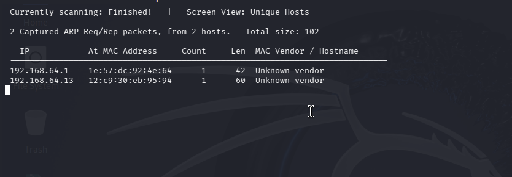

It found the gateway (`.1`) and my Metasploitable box (`.13`). "Unknown vendor" appears because VM MAC addresses are randomly generated and do not match a real hardware manufacturer. On a real network you would see "Dell", "Cisco", etc.

### Ping scan with Nmap

```bash
nmap -sn 10.49.140.148        # one host: is it up?
nmap -sn 192.168.64.0/24      # whole subnet
```

`-sn` means "ping scan, skip the port scan." The output is deliberately tiny: it only confirms the host is up. (The old name was `-sP`; it still works but is deprecated, so use `-sn`.) On a LAN, Nmap actually uses ARP underneath for this, which is why you see "ARP Ping Scan" at the top of the output.

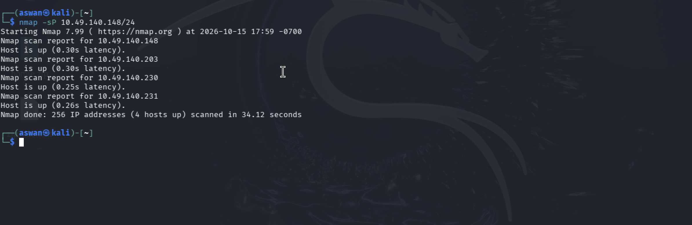

---

## 2. Scan types

**What this does:** the three core ways Nmap checks whether a port is open, and the tradeoffs between them.

### SYN scan `-sS` — half-open / stealth

My default. It sends a SYN; if it gets SYN-ACK back the port is open, then it immediately sends **RST** to drop the connection instead of finishing the handshake. Because the connection never fully completes, it is faster and quieter. It needs root.

```bash
sudo nmap -sS -p- -v 10.49.140.148
```

### TCP connect scan `-sT` — full connect

Completes the **full** three-way handshake (SYN → SYN-ACK → ACK). It does **not** need root, because it uses the operating system's normal `connect()` call. The downside: it is louder, since the fully completed connections get logged by the target.

```bash
sudo nmap -sT -p- -v 10.49.140.148
```

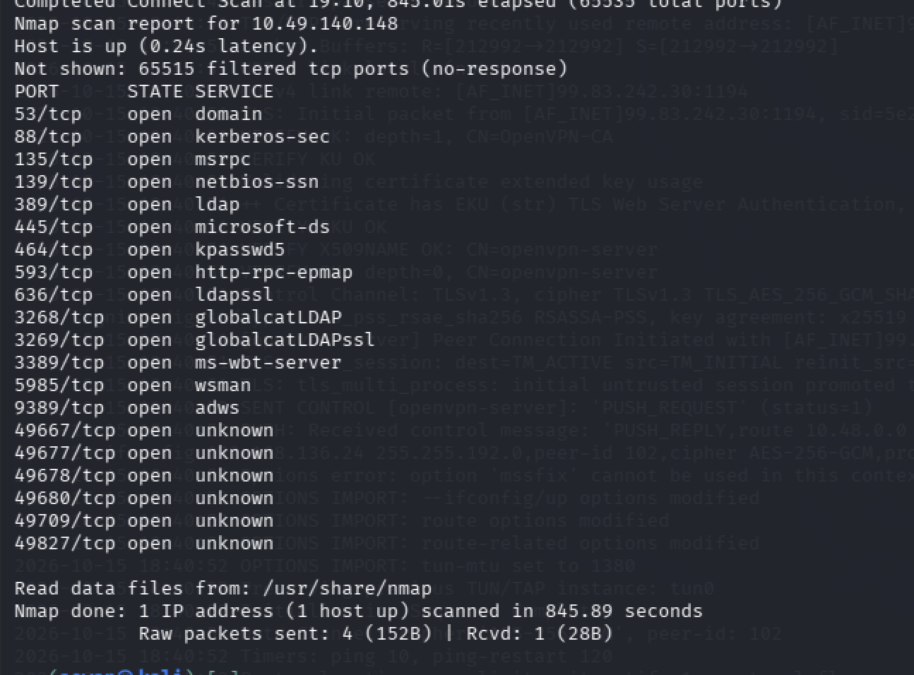

**The difference, proven by packet counts.** I ran both as full `-p-` scans against the same host:

| Scan | Raw packets sent | Time | Why |
|------|------------------|------|-----|
| `-sS` | 131,239 | 295s | Nmap hand-crafts every packet |
| `-sT` | 4 | 845s | the OS does the connecting, so Nmap sends almost nothing |

Same open ports, completely different mechanism. `-sS` fires 131,000 raw packets; `-sT` lets the kernel work and sends 4.

### UDP scan `-sU`

Everything above is TCP. But many important services run on **UDP**: DNS (53), SNMP (161), DHCP (67), NTP (123). A TCP-only scan misses all of them.

UDP is slow by nature. TCP gives clear answers (SYN-ACK = open, RST = closed), but UDP is connectionless, so an open port usually just stays silent and Nmap has to wait out a timeout on every port. Keep it limited:

```bash
sudo nmap -sU --top-ports 20 192.168.64.13
```

**What NOT to do** (I tried it so I could see the failure, see [`outputs/udp-full-minrate.txt`](outputs/udp-full-minrate.txt)):

```bash
sudo nmap -sU -v -p- 192.168.64.13 --min-rate 10000
```

Forcing 10,000 packets/sec at all 65,535 UDP ports finished in 13 seconds but produced garbage: `65529 open|filtered (no-response)` and `11 out of 17 dropped probes`. UDP has to *wait* for replies, so rushing it just drops the probes. Lesson: `--min-rate` speeds up *sending*, not *waiting*, so it is the wrong tool for UDP.

---

## 3. Port selection

**What this does:** controls which ports Nmap checks. By default it scans the top 1000.

| Syntax | Meaning |
|--------|---------|
| `-p 80` | one port |
| `-p 22,23,25,443` | a list |
| `-p 1-1000` | a range |
| `-p-` | all 65,535 ports |

TCP ports run from **0 to 65535** (a 16-bit field = 65,536 total; 1 to 65535 are scannable). Three zones worth memorizing:

| Range | Name | Examples |
|-------|------|----------|
| 0–1023 | Well-known | 22 SSH, 80 HTTP, 443 HTTPS, 445 SMB |
| 1024–49151 | Registered | 3389 RDP, 3306 MySQL |
| 49152–65535 | Dynamic / ephemeral | temporary ports the OS uses for outbound connections |

**Why `-p-` matters:** my quick top-1000 scan missed services on high ports. The full `-p-` scan caught `9389` (AD Web Services) and a batch of `49xxx` RPC dynamic ports a top-1000 scan never sees.

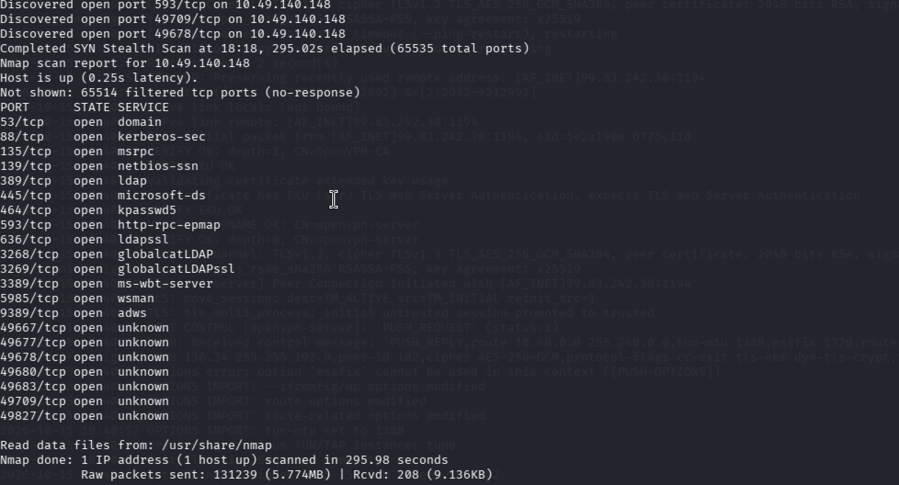

**Targeted scan is the fast follow-up.** Once I knew what was open, I version-scanned only those ports:

```bash
nmap -sS -sV -p 22,23,25,443 -v 192.168.64.13
```

Under a second, vs over two minutes for the full scan. **Full scan to discover, targeted scan to dig in.**

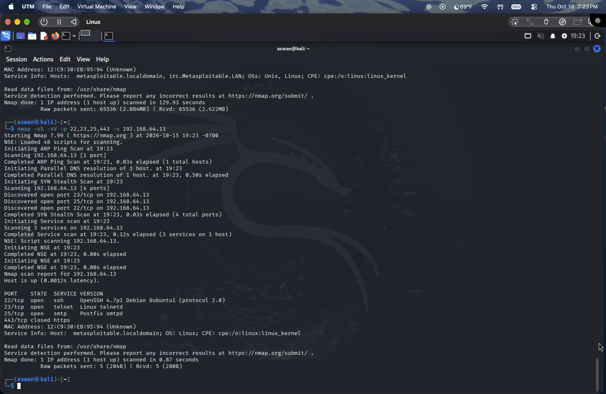

---

## 4. Service and version detection

**What this does:** figures out *what software* and *which version* is running on each open port.

```bash
nmap -sS -sV -p- 192.168.64.13
```

`-sV` sends probes to each open port and matches the responses against Nmap's service-fingerprint database. The version is the bridge from recon to attack: an open port says a door exists, but a version like `vsftpd 2.3.4` tells you which known exploits might work.

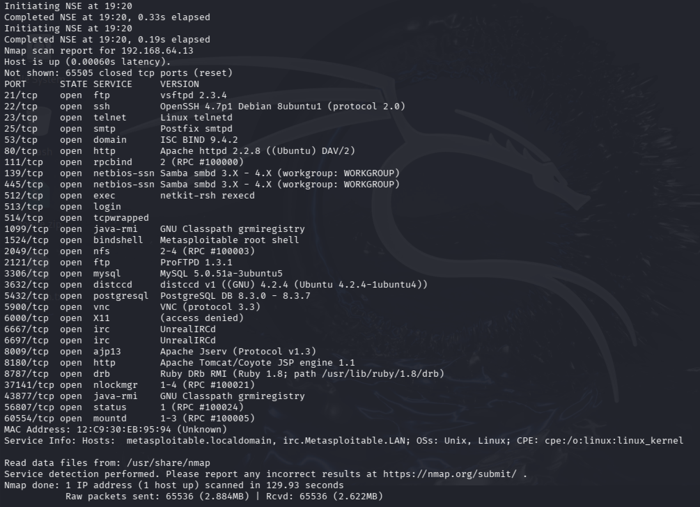

---

## 5. Default scripts (NSE)

**What this does:** runs Nmap's built-in scripts to pull extra detail out of each service.

```bash
nmap -sS -sV -sC -p- 192.168.64.13
```

`-sC` runs the default set of NSE (Nmap Scripting Engine) scripts. Where `-sV` tells you the version, `-sC` goes further and finds *interesting details*: anonymous logins, shares, certificates, misconfigurations. Full output in [`outputs/metasploitable-full-sV-sC.txt`](outputs/metasploitable-full-sV-sC.txt). A few things it surfaced on Metasploitable:

| Finding | Why it matters |
|---------|----------------|
| `ftp-anon: Anonymous FTP login allowed` | log in with no password |
| SMB `message_signing: disabled (dangerous, but default)` | exposed to relay / MITM |
| `SSLv2 supported` + export ciphers | ancient, broken crypto |
| `smb-os-discovery` → hostname, domain, OS | free recon for an attacker |

`-sC` is the same as `--script=default`. You can also run specific scripts, e.g. `--script=banner` (see [Banner grabbing](#10-banner-grabbing)).

---

## 6. Saving output

**What this does:** writes scan results to files so you never have to re-run a long scan.

```bash
nmap -sS -sV -p 22,23,25,443 -v 192.168.64.13 -oA meta
```

`-oA` saves all three formats at once from one base name:

| File | Format | Use |
|------|--------|-----|
| `meta.nmap` | normal / readable | read it later |
| `meta.xml` | XML | feed into other tools |
| `meta.gnmap` | grepable | `grep open meta.gnmap` |

(Individually: `-oN` normal, `-oX` XML, `-oG` grepable.) Saving output is a basic professional habit — you do not want to lose a 10-minute scan because the terminal closed.


---

# Part 2 — Advanced

## 7. OS detection and aggressive scan

**What this does:** guesses the target's operating system and, with `-A`, runs everything at once.

`-A` is the "give me everything" scan: it bundles `-sV`, `-O`, `-sC`, and traceroute. So `-A -O` is redundant — `-A` already includes `-O`.

```bash
sudo nmap -A -p 22,23,25,139,445 192.168.64.13
```

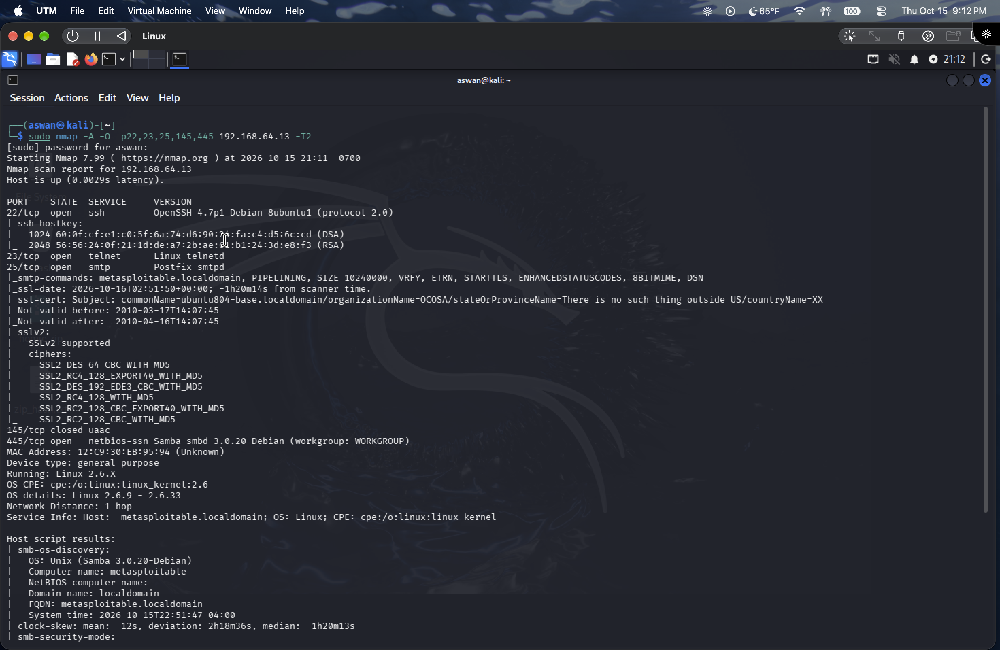

Important: OS detection is a **best guess, not a fact**. The output said `97% Linux 2.6.x` but also `No exact OS matches`. It works by sending odd and malformed packets and fingerprinting how the OS responds — which is exactly why it is so detectable (next section).

---

## 8. Timing templates

**What `-T` means:** `-T` sets how fast and aggressive the scan is, on a scale from 0 to 5. It controls delays between probes, timeouts, and how many probes run in parallel. The key idea: **higher number = faster, but louder.**

| Template | Name | Speed | Use |
|----------|------|-------|-----|
| `-T0` | Paranoid | slowest | evade detection, IDS-heavy targets |
| `-T1` | Sneaky | very slow | low and quiet |
| `-T2` | Polite | slow | gentle, avoids overloading the target |
| `-T3` | Normal | default | the default if you set nothing |
| `-T4` | Aggressive | fast | labs, CTFs, reliable networks |
| `-T5` | Insane | fastest | very fast networks only |

I mixed this up at first and thought `-T2` sped things up — it actually **slows** them down. `-T4` is the usual sweet spot for labs. `-T5` can be *too* aggressive and miss ports on a laggy network, because replies time out before they arrive.

Separate from `-T`, `--min-rate 10000` forces a minimum packets-per-second rate. It is the fastest and loudest option — fine in a lab, but in the real world it floods the target and trips intrusion-detection systems.

---

## 9. Firewall and IDS evasion

**What this does:** techniques to make a scan harder for a firewall or intrusion-detection system (IDS) to spot. These are the "be sneaky" flags.

First, *why* aggressive scans get caught: `-A` and especially `-O` send unusual packets (illegal flag combinations, probes to closed ports) that normal traffic never produces, so an IDS flags them instantly. On fragile devices those odd probes can even crash the service. So in the real world you stay quiet and only go loud when stealth does not matter.

```bash
sudo nmap -A -f -v --data-length 5 -p 22,23,25,139,445 192.168.64.13 -T2
```

Full output in [`outputs/evasion-fragment-datalength.txt`](outputs/evasion-fragment-datalength.txt).

| Flag | Trick |
|------|-------|
| `-f` | fragment packets into tiny pieces so some firewalls cannot inspect them |
| `--data-length 5` | add random bytes so the packet size no longer matches Nmap's known signature |
| `-T2` | go slow to stay under rate-based detection |

**Honest reality check:** these worked great years ago. Modern firewalls reassemble fragments and are not fooled by a few extra bytes, so `-f` and `--data-length` are mostly defeated by current gear. Still worth knowing for old targets and CTFs.

Related evasion flags in the same family:

| Flag | What it does |
|------|--------------|
| `-D RND:5` | decoys — spoof 5 fake source IPs so your real one hides in the crowd |
| `--source-port 53` | pretend traffic comes from a trusted port like DNS |
| `-S <ip>` | spoof the source IP address |
| `-Pn` | skip host discovery (useful when ping is blocked) |

---

## 10. Banner grabbing

**What this does:** reads the greeting a service sends when you connect to it, which often reveals the software and version by hand.

A banner is that greeting. Connect to FTP and it literally says `220 (vsFTPd 2.3.4)`. Grabbing banners manually is the hand-done version of what `-sV` automates — doing it myself made it clear where version info actually comes from.

```bash
nmap -sV --script=banner 192.168.64.13 -v
```

Full output in [`outputs/banner-grab.txt`](outputs/banner-grab.txt). Some of what the services announced:

| Port | Banner | Reveals |
|------|--------|---------|
| 21 | `220 (vsFTPd 2.3.4)` | FTP version |
| 22 | `SSH-2.0-OpenSSH_4.7p1 Debian` | SSH version |
| 25 | `220 metasploitable.localdomain ESMTP Postfix` | mail server + hostname |
| 1524 | `root@metasploitable:/#` | a root shell, wide open |

That port 1524 banner is a root command prompt advertising itself. The service told me it was a backdoor just by me reading its greeting. You can also grab banners manually with `nc <ip> 21` or `telnet <ip> 21`.

---

# Key concepts

## Open vs closed vs filtered

This was the single most useful thing I learned, and the whole reason I scanned two different machines.

| State | Meaning | What you see |
|-------|---------|--------------|
| **open** | a service is listening | SYN-ACK reply |
| **closed** | nothing listening, but the host is reachable | RST reply |
| **filtered** | a firewall is silently dropping packets | no response |

The TryHackMe Windows box returned ports **filtered** (firewall dropping packets), which is itself useful — it tells you a firewall is present. Metasploitable returned **closed** on unused ports (no firewall, so it actively replies with RST).

That one difference explains everything else I saw:

| | TryHackMe (Windows, firewalled) | Metasploitable (Linux, no firewall) |
|---|---|---|
| Unused ports | filtered (no-response) | closed (reset) |
| Full `-p-` scan speed | slow (waits on timeouts) | fast (instant RST) |
| `-sV` output | limited | rich, old versions everywhere |

A firewalled host makes Nmap wait out a timeout on every dead port, which is why those scans crawled. The open host answers instantly, so the same scan finished in seconds.

---

## The TCP three-way handshake (Wireshark)

Since the SYN vs connect scans are all about the handshake, I captured one in Wireshark to see it on the wire.

The handshake is three packets: **SYN → SYN-ACK → ACK**. Each side picks its own random starting sequence number (the ISN — randomized on purpose so an attacker cannot predict it and hijack the session).

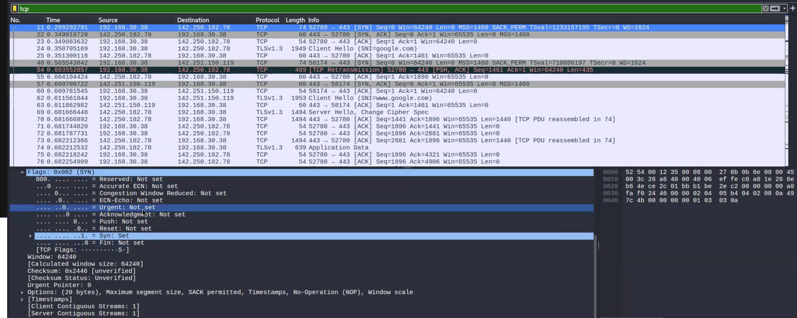

The first packet has only the SYN flag set (`0x002`):

| Packet | Flags | Raw Seq | Raw Ack | Meaning |
|--------|-------|---------|---------|---------|
| 1. SYN | SYN | 4132337077 | 0 | "here is my starting number" |
| 2. SYN-ACK | SYN+ACK | 55616001 | 4132337078 | "here is mine, and I ack yours + 1" |
| 3. ACK | ACK | 4132337078 | 55616002 | "I ack your number + 1" |

The thing I got wrong at first: the **+1 is in the ACK number, not the sequence number**. Each side keeps its own independent counter, and the +1 is each side confirming it received the other's SYN.

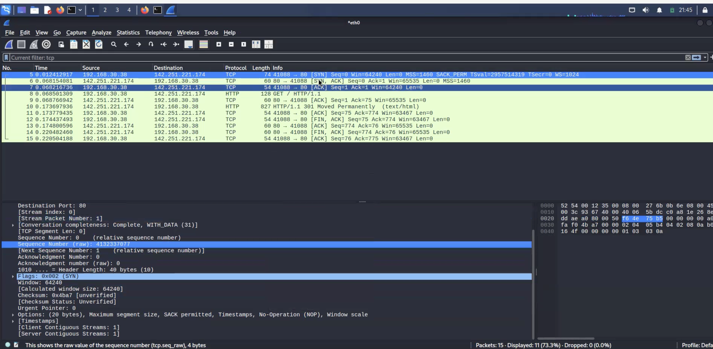
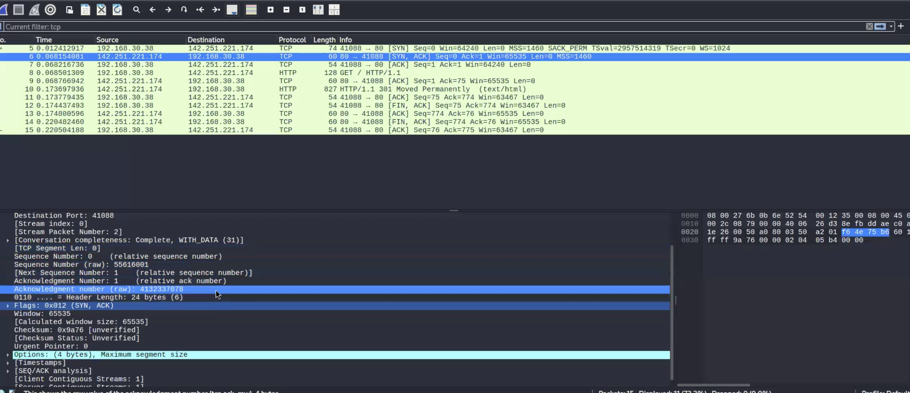
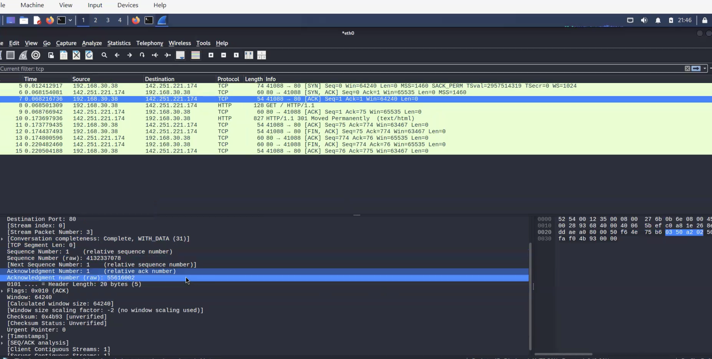

My own diagram of the three packets and their sequence numbers:

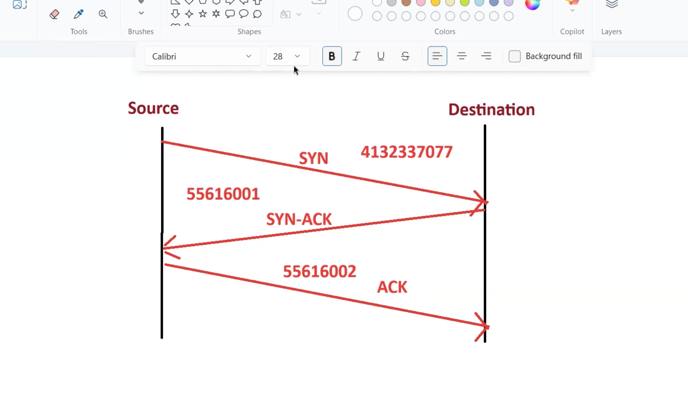

This ties straight back to the scans: `-sT` completes this full handshake, while `-sS` cuts it off with RST right after the SYN-ACK — which is why it is called half-open.

---

Built by Aswan Syed. [LinkedIn](https://www.linkedin.com/in/aswan-syed-3154703b4)
