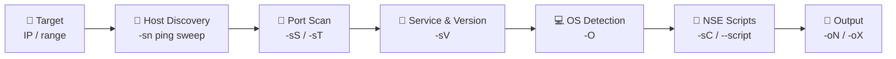

<div align="center">

# 🔍 Nmap Recon Lab

### Hands-on network reconnaissance & port scanning with Nmap — host discovery, service/version detection, and OS fingerprinting.


</div>

---

## 📌 Overview

Nmap (Network Mapper) is the go-to tool for **network discovery and security auditing**. This repo documents hands-on practice: finding live hosts, mapping open ports, identifying running services and versions, and fingerprinting operating systems — the reconnaissance groundwork every pentester and SOC analyst relies on.

> **Think of it like this:** before you break into (or defend) a building, you walk the perimeter — which doors exist, which are unlocked, what's behind each one, and who's inside. Nmap is that walkthrough, for a network.

---

## 🗺️ The Recon Workflow



---

## 🧰 Core Scan Types

| Scan | Flag | What it does |
|:---|:---|:---|
| **Ping sweep** | `-sn` | Find live hosts, no port scan |
| **SYN (stealth) scan** | `-sS` | Fast, half-open TCP scan (needs root) |
| **TCP connect scan** | `-sT` | Full TCP handshake (no root needed) |
| **UDP scan** | `-sU` | Scan UDP ports (DNS, SNMP, DHCP) |
| **Version detection** | `-sV` | Identify service + version |
| **OS detection** | `-O` | Fingerprint the operating system |
| **Default scripts** | `-sC` | Run common NSE enumeration scripts |
| **Aggressive** | `-A` | `-sV -O -sC` + traceroute, all in one |

---

## 💻 Commands I Practiced

### 1️⃣ Host Discovery
```bash
# Find live hosts on a subnet (no port scan)
nmap -sn 192.168.1.0/24
```

### 2️⃣ Port Scanning
```bash
# Stealth SYN scan of the top 1000 ports
sudo nmap -sS 192.168.1.10

# Scan all 65535 ports
sudo nmap -p- 192.168.1.10
```

### 3️⃣ Service & Version Detection
```bash
# What's running, and what version?
nmap -sV 192.168.1.10
```

### 4️⃣ OS Detection
```bash
# Fingerprint the OS
sudo nmap -O 192.168.1.10
```

### 5️⃣ Aggressive All-in-One
```bash
# Version + OS + default scripts + traceroute
sudo nmap -A 192.168.1.10
```

### 6️⃣ Saving Output
```bash
# Normal + XML output for reporting
nmap -sV -oN scan.txt -oX scan.xml 192.168.1.10
```

---

## 📸 Scan Results

> _Screenshots of live scans will go here — host discovery, open ports, version detection, and OS fingerprinting._

<!-- Example once screenshots are added:


-->

---

## 🧠 Key Takeaways

- **`-sS` vs `-sT`** — SYN scan never completes the handshake, so it's faster and quieter; connect scan is louder but needs no root.
- **Open vs filtered** — "filtered" means a firewall is dropping packets, which is itself useful recon.
- **`-sV` is gold** — a service version (e.g. `vsftpd 2.3.4`) is often the thread that leads straight to a known CVE.
- **Always save output** — `-oN`/`-oX` turns a scan into evidence you can cite later.

---

## 🧠 Skills Demonstrated

`Nmap` · `Network Reconnaissance` · `Port Scanning` · `Service Enumeration` · `OS Fingerprinting` · `NSE Scripting` · `TCP/UDP` · `Kali Linux`

---

<div align="center">

**Built by [Aswan Syed](https://www.linkedin.com/in/aswan-syed-3154703b4)** · Breaking into cybersecurity, one lab at a time.

</div>
